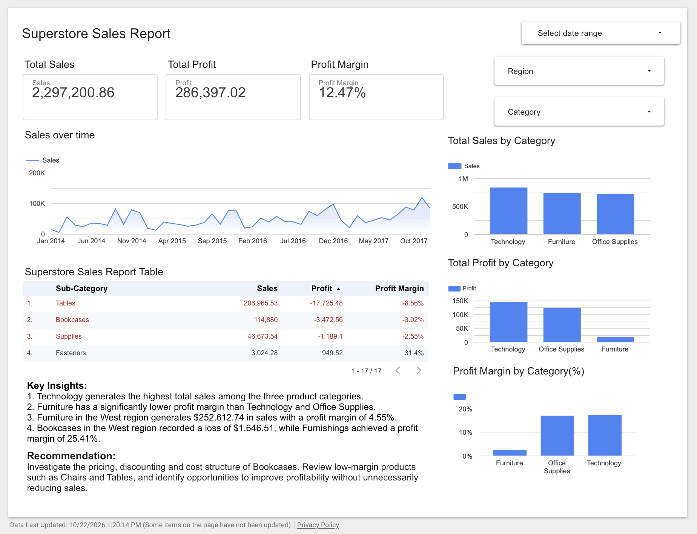
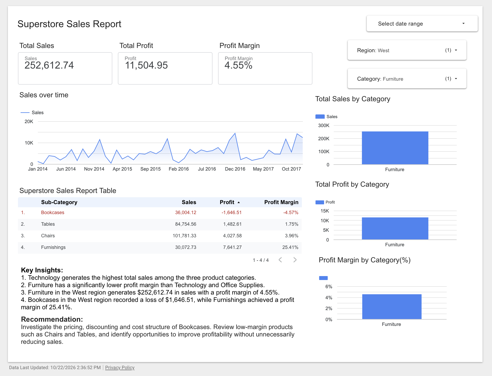

# Superstore Sales & Profitability Analysis

### Interactive Business Intelligence Dashboard | Google Looker Studio

## Project Overview

Developed an interactive business intelligence dashboard to analyze retail sales performance, profitability, and regional trends using the Superstore Sales Dataset.

The objective was to identify high-performing product categories, examine profit margins, and investigate loss-making sub-categories.

## Tools & Technologies

- **Google Looker Studio:** Interactive dashboard development and data visualization
- **Google Sheets:** Dataset preparation and data connection
- **GitHub:** Project documentation and portfolio hosting

## Dataset

- **Source:** [Superstore Sales Dataset](https://www.mathewkanalytics.com/datasets/superstore-sales/)
- **Records:** Approximately 10,000
- **Period:** 2014–2017

## Dashboard Preview

## Key Performance Indicators

| Metric | Value |
|---|---|
| Total Sales | $2,297,200.86 |
| Total Profit | $286,397.02 |
| Profit Margin | 12.47% |

## Dashboard Features

- Monthly sales trend analysis
- Sales and profit comparison by category
- Profit margin analysis using calculated fields
- Interactive region and category filters
- Sub-category profitability analysis
- Conditional formatting to highlight negative profits

## Key Business Insights

1. Technology generated the highest total sales among the three product categories.
2. Furniture showed significantly lower profitability than Technology and Office Supplies.
3. Furniture in the West region generated $252,612.74 in sales with a 4.55% profit margin.
4. Bookcases in the West region recorded a loss of $1,646.51.
5. Furnishings in the West region achieved a 25.41% profit margin.

## Regional Deep Dive — West Region Furniture

## Business Recommendations

Investigate the pricing, discounting, and cost structure of loss-making Bookcases. Review low-margin Furniture products such as Chairs and Tables to identify opportunities for improving profitability.

## Dashboard Link

Add your public Looker Studio report link here.

## Future Improvements

- Analyze year-over-year revenue growth
- Investigate regional profit differences
- Explore product-level profitability
- Rebuild the dashboard in Power BI
